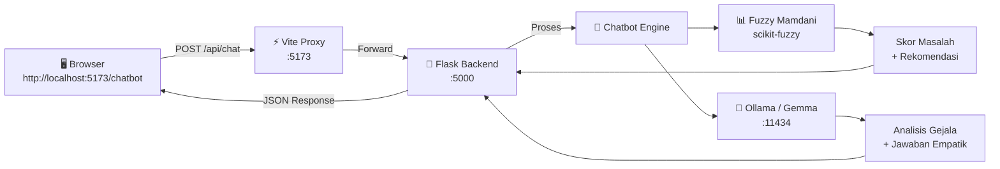
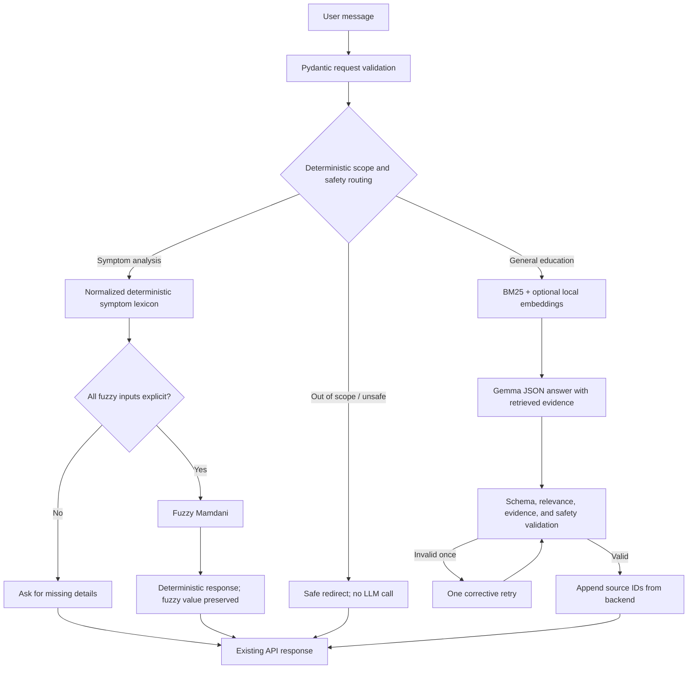

# 🌸 Panduan Setup — Rijema Dira Chatbot System

## Arsitektur Sistem




## Cara Menjalankan

> [!IMPORTANT]
> Ada **3 service** yang harus jalan: **Ollama**, **Backend Flask**, dan **Frontend Vite**.

### Cara Cepat (Satu Klik)

1. **Pastikan Ollama sudah berjalan** — buka terminal, ketik:
   ```
   ollama serve
   ```
   Biarkan terminal ini terbuka.

2. **Double-click** file `start_system.bat` di root folder project.
   - Ini akan otomatis install dependencies dan jalankan backend + frontend.

3. **Buka browser** ke: **http://localhost:5173/chatbot**

### Cara Manual (Step by Step)

**Terminal 1 — Ollama:**
```
ollama serve
```

**Terminal 2 — Backend:**
```
cd backend
pip install -r requirements.txt
python app.py
```

**Terminal 3 — Frontend:**
```
npx vite
```

## Fitur yang Sudah Berjalan

- ✅ **Status koneksi real-time** — bar hijau/kuning/merah di atas chat menunjukkan apakah backend & Ollama sudah aktif
- ✅ **Error handling** — kalau server mati atau Ollama belum aktif, pesan error ditampilkan langsung di chat (bukan crash)
- ✅ **Loading animation** — icon berputar saat bot sedang memproses (bukan cuma "sedang mengetik")
- ✅ **Quick Topics** — klik topik cepat di sidebar tetap bekerja
- ✅ **Percakapan Baru** — tombol refresh tetap bekerja
- ✅ **Bahasa santai** — chatbot bisa memahami "muka gw merah gatel banget" berkat normalisasi slang

## Alur Chatbot (Diagram)



> [!NOTE]
> Chatbot ini membutuhkan **Ollama** dengan model **gemma3:4b** yang sudah terdownload.
> Jika belum punya, jalankan: `ollama pull gemma3:4b`

> [!WARNING]
> Pesan yang memerlukan jawaban AI dapat membutuhkan waktu beberapa detik, tergantung performa komputer dan Ollama. Pertanyaan yang perlu klarifikasi gejala dijawab tanpa memanggil model generasi.

## Catatan backend reliability

- Audit dan urutan migrasi tersedia di `backend/AUDIT_AND_MIGRATION.md`.
- Symptom score sekarang diambil dari lexicon deterministik. Gejala yang tidak disebut tetap unknown; fuzzy analysis meminta klarifikasi daripada mengisinya dengan angka default.
- Pertanyaan edukasi umum memakai dokumen ringkas dengan metadata sumber di `backend/knowledge_base/curated_knowledge.json`. Retrieval memakai BM25 lokal dan semantic reranking opsional dari Ollama dengan Reciprocal Rank Fusion; jika model embedding tidak tersedia, retrieval tetap memakai BM25. Reranking semantic dibatasi pada kandidat yang cocok secara kata kunci.
- Ollama hanya merangkai jawaban edukasi dari dokumen yang ditemukan. Jawaban gejala dan hasil fuzzy dibuat deterministik di backend; model tidak pernah menerima atau mengubah skor fuzzy.
- Scope dan permintaan medis berisiko dirutekan tanpa LLM.
- Request API bersifat stateless dan tidak menerima riwayat; ini mencegah kebocoran antarpercakapan, tetapi follow-up tidak membawa konteks sebelumnya.
- Trace prompt, retry, validasi, konfigurasi Ollama, dan batasan ada di `backend/CHATBOT_DEBUGGING.md`.
- Dokumen awal bersumber dari NHS dan American Academy of Dermatology. Ini bukan korpus lengkap dan masih perlu tinjauan dermatolog sebelum digunakan sebagai panduan klinis.
- Install dependency backend dengan `pip install -r backend/requirements.txt`. Tes offline: `cd backend` lalu `python -m unittest discover -s tests`.
- Untuk semantic reranking, jalankan `ollama pull nomic-embed-text`; tanpa itu, sistem tetap berfungsi memakai BM25 saja.
