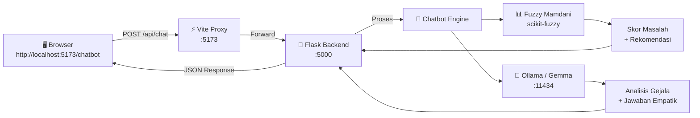
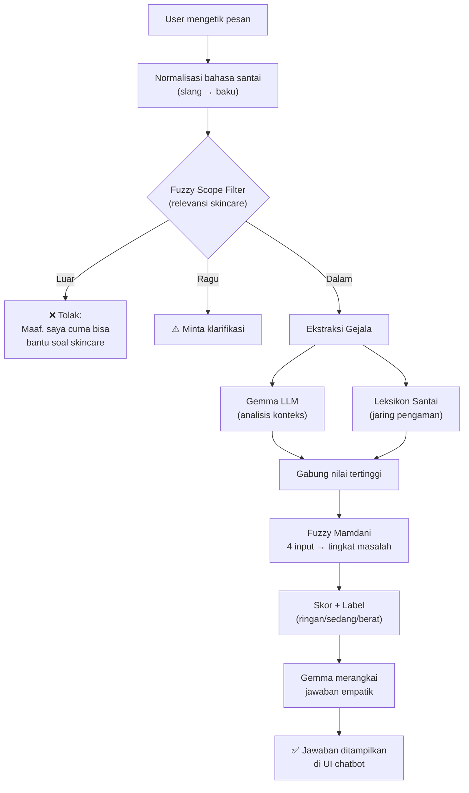

# 🌸 Panduan Setup — Rijema Dira Chatbot System

## Arsitektur Sistem




## Cara Menjalankan

> [!IMPORTANT]
> Ada **3 service** yang harus jalan: **Ollama**, **Backend Flask**, dan **Frontend Vite**.

### Cara Cepat (Satu Klik)

1. **Pastikan Ollama sudah berjalan** — buka terminal, ketik:
   ```
   ollama serve
   ```
   Biarkan terminal ini terbuka.

2. **Double-click** file `start_system.bat` di root folder project.
   - Ini akan otomatis install dependencies dan jalankan backend + frontend.

3. **Buka browser** ke: **http://localhost:5173/chatbot**

### Cara Manual (Step by Step)

**Terminal 1 — Ollama:**
```
ollama serve
```

**Terminal 2 — Backend:**
```
cd backend
pip install flask flask-cors requests scikit-fuzzy numpy
python app.py
```

**Terminal 3 — Frontend:**
```
npx vite
```

## Fitur yang Sudah Berjalan

- ✅ **Status koneksi real-time** — bar hijau/kuning/merah di atas chat menunjukkan apakah backend & Ollama sudah aktif
- ✅ **Error handling** — kalau server mati atau Ollama belum aktif, pesan error ditampilkan langsung di chat (bukan crash)
- ✅ **Loading animation** — icon berputar saat bot sedang memproses (bukan cuma "sedang mengetik")
- ✅ **Quick Topics** — klik topik cepat di sidebar tetap bekerja
- ✅ **Percakapan Baru** — tombol refresh tetap bekerja
- ✅ **Bahasa santai** — chatbot bisa memahami "muka gw merah gatel banget" berkat normalisasi slang

## Alur Chatbot (Diagram)



> [!NOTE]
> Chatbot ini membutuhkan **Ollama** dengan model **gemma3:4b** yang sudah terdownload.
> Jika belum punya, jalankan: `ollama pull gemma3:4b`

> [!WARNING]
> Proses analisis membutuhkan waktu **5-15 detik** per pesan (karena memanggil Ollama 3x per pesan).
> Ini normal dan tergantung performa komputer kamu.
